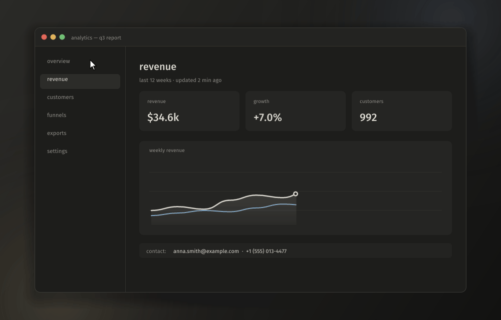
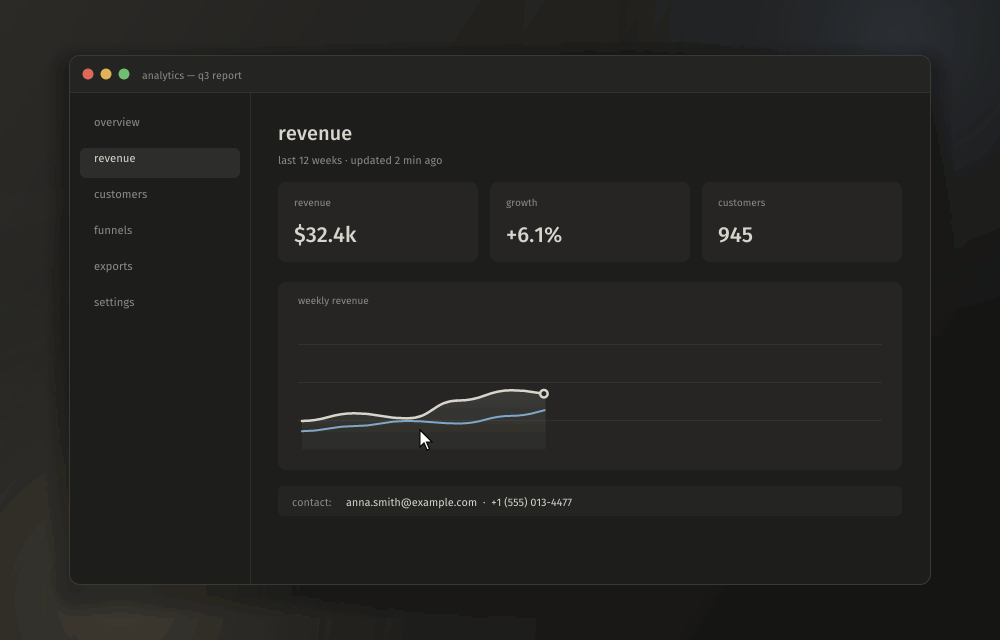

<div align="center">


# blinker

**A fast, quiet screenshot and screen recording tool for Windows and macOS.**
Capture, annotate and share in a couple of keystrokes. It lives in the tray (the menu bar on a Mac) and stays out of the way.

**English** · [Русский](README.ru.md)


<sub>select an area → arrow → numbered steps → blur the email → copy</sub>

</div>

## Features

### Screenshots

- **Area capture.** The screen freezes and dims around your selection. Click a window to capture just that window. A loupe shows exact pixels, coordinates and the HEX color under the cursor.
- **Draw before you capture.** Arrows, pen, marker, numbered steps, blur, black-out and text, plain or on a plate. Everything inside the frame is baked into the shot.
- **Tools panel wherever you like:** at the top of the screen, above or below the selection, or as a column to its right.
- **One-key actions:** copy, save, open in the editor, pin on top of other windows, make a "beauty shot" (background, padding, rounded corners, shadow, 16:9 / 1:1 / 4:5) or upload and copy the link.
- **Full screen, active window, repeat the last area.**
- **Notification with a preview.** Drag it straight into a chat, a browser or Explorer as a file.

### Editor

- Arrow, line, rectangle, ellipse, pen, marker, text, pixelate, steps, crop.
- Colors, stroke widths, undo/redo, zoom and pan.

### Screen recording

<div align="center">

<sub>press <code>Ctrl+Shift+PrtSc</code> → select an area → record → stop: the video is saved</sub>
</div>

- **An area, a window or a whole monitor** to MP4 (H.264 or HEVC) on the GPU's hardware encoder. Frames go GPU → encoder with no copies through memory.
- **Window recording** keeps following the window even when it's covered or moved, and the control pill follows it too.
- **System sound and microphone on separate tracks**, pause and resume, and visible clicks and key combos (plain typing is never shown).
- **GIF recording** with a built-in encoder: one global palette and only the changed rectangles, so GIFs stay small.
- **Instant replay.** The last minutes (1 to 30, you choose) are always ready to save with one hotkey, without re-encoding; saving can start the replay over. The tray icon is red while it records.
- **Video editor:** trim, track volume and mute, markers with notes (`M`), export to MP4 (one mixed track for messengers or separate tracks for editing), GIF, or with the video off the sound alone as MP3 / M4A / WAV.
- **Upload and share:** by default to [post.blinker.cool](https://post.blinker.cool) (no sign-up, 3 days, videos up to 100 MB): every link has a page with an image viewer or a player that shows the video's markers. Or your own server, or any ShareX uploader (`.sxcu`).
- **Moving from ShareX** in one click: hotkeys, folder, format, after-capture steps, notification, sound and the uploader.

<div align="center">

<sub>something happened on screen → <code>Ctrl+Alt+PrtSc</code> → the last 30 seconds are already a video</sub>
</div>

### Everyday

- Saves to `Pictures/Blinker/<date>/pics` and `…/videos` (or a single folder) as PNG, lossless WebP or JPEG.
- Tray menu, and both mouse buttons on the tray icon can be bound to any action.
- Every action can have several hotkeys.
- Russian and English interface.
- The "Graphite" look: warm dark gray with one light accent, Fira Sans / Fira Mono.
- Lightweight: each window (overlay, editor, settings) is created on demand and fully destroyed when closed.

## Hotkeys

| Where | Keys |
| --- | --- |
| Anywhere | `PrtSc` area · `Ctrl+PrtSc` screen · `Shift+PrtSc` repeat last area · `Ctrl+Shift+PrtSc` record (again to stop) · `Ctrl+Alt+P` pause · `Ctrl+Alt+PrtSc` save replay |
| Selecting | drag: area · click: window · `Space` monitor · `Ctrl+A` all monitors · `Enter` / `Ctrl+C` / double click: copy · `Ctrl+S` save · `E` editor · `P` pin · `B` beauty shot · `U` upload · `0`–`9` tools · `Ctrl+Z` undo · arrows nudge (`Shift` ×10) · wheel: loupe zoom · `C` copy color · `Esc` / right click: cancel |
| Editor | `V A L R O P M T B N C` tools · `1 2 3` width · `Ctrl+Z/Y` · `Ctrl+C` · `Ctrl+S` · `Ctrl+Shift+S` · `Space`+drag pan · `Ctrl+0` fit · `Ctrl+1` 100% |
| Video editor | `Space` play/pause · `←`/`→` ±1 s (`Shift` ±5 s) · `I`/`O` in/out · `M` marker · `Home`/`End` · `Ctrl+S` save |

All global hotkeys can be changed in settings → hotkeys.

> If `PrtSc` opens the Windows Snipping Tool instead, turn off *Settings → Accessibility → Keyboard → Use the Print Screen key to open screen capture*.

**On a Mac** ⇧⌘3, ⇧⌘4 and ⇧⌘5 belong to the system, so the defaults sit next to them:

| Where | Keys |
| --- | --- |
| Anywhere | `⇧⌘2` area · `⇧⌘1` screen · `⌥⇧⌘2` repeat last area · `⇧⌘7` record (again to stop) · `⌃⌥P` pause · `⌥⇧⌘7` save replay |
| Selecting, editors | the same keys as above with `⌘` instead of `Ctrl` |

## Download

Grab `blinker.exe` from [Releases](https://github.com/justkiddingxd/blinker/releases/latest) and run it. It is a single file with nothing to install. It opens the settings window and keeps running in the tray. Autostart is in settings → system.

Windows SmartScreen may warn about an unsigned app: click *More info → Run anyway*.

**macOS 14 Sonoma or newer:** download `Blinker.dmg` from [blinker.cool](https://blinker.cool) or Releases, drag Blinker onto *Applications* and open it. It lives in the menu bar. The app isn't notarized by Apple, so the first time macOS blocks it: press *Done*, then *System Settings → Privacy & Security → Open Anyway* (or run `xattr -dr com.apple.quarantine /Applications/Blinker.app`). The site has the [step-by-step guide](https://blinker.cool/#mac). macOS asks for a few permissions, each when it is first needed:

- **Screen & System Audio Recording** for screenshots and recordings. After allowing it, quit blinker from its menu and open it again.
- **Microphone**, if you record it (needs macOS 15).
- **Input Monitoring**, only to show key combos in recordings. Clicks are shown without it.

## Build

You need [Rust](https://rustup.rs) (stable, edition 2024) and Windows 10 1903+ or Windows 11, or macOS 14+ with the Xcode command line tools (`xcode-select --install`).

```bash
git clone https://github.com/justkiddingxd/blinker
cd blinker
cargo build --release
```

The result is a single `target/release/blinker.exe` with nothing to install.

```text
blinker.exe                  settings window + tray
blinker.exe --background     tray only (how autostart launches it)
blinker.exe --capture        start selecting an area right away
blinker.exe picture.png      open an image in the editor
```

Settings live in `%APPDATA%\Blinker\config.toml`.

**Releases:** push a tag like `v0.2.0` (the same as `version` in `Cargo.toml`) and GitHub Actions builds `blinker.exe`, `Blinker.dmg` and `Blinker-macos.zip` and attaches them to the release (`.github/workflows/release.yml`; the Mac certificate comes from the `BLINKER_P12_BASE64` / `BLINKER_P12_PASSWORD` secrets). Running apps see the new version in settings and update themselves in one click.

On a Mac, `scripts/macos-app.sh` builds `target/release/Blinker.app`, `Blinker.dmg` and a zip of it (`UNIVERSAL=1` for Apple silicon + Intel). The dmg window is laid out by [dmgbuild](https://github.com/dmgbuild/dmgbuild), which the script installs into `target/dmgbuild`; its background is drawn by `scripts/dmg-background.swift`. Run `scripts/macos-signing.sh` once before: it makes a signing certificate in its own keychain, and every build signed with it keeps the Screen Recording permission (signed ad hoc, each build has to be allowed again). Back up the `.p12` it prints, since a new certificate means every user allows recording again. The same flags work on the binary inside, `Blinker.app/Contents/MacOS/blinker`. Settings live in `~/Library/Application Support/Blinker/config.toml`, captures go to `~/Pictures/Blinker`. The capture overlay is a window on every display (each Mac display has its own space); a selection stays within one display.

**Optional:** with [ffmpeg](https://ffmpeg.org) on `PATH` (or from Homebrew on a Mac), blinker uses it to re-encode videos for Telegram with a tuned NVENC / x264 recipe. Without it the built-in encoder does the job: Media Foundation on Windows, VideoToolbox on a Mac.

## Upload server protocol

Uploads go to [post.blinker.cool](https://post.blinker.cool) unless you set your own server. The server behind it is in [`server/`](server/README.md): `docker compose up` runs your own. Any server that speaks this works:

```text
POST <url from settings>
Authorization: Bearer <token>          (if set)
Content-Type: image/png | image/jpeg | image/webp | image/gif | video/mp4 | audio/mpeg | audio/mp4 | audio/wav
X-Filename: <file name, percent-encoded UTF-8>
X-Blinker-Markers: <percent-encoded [{"t": 12.5, "text": "…"}]>   (videos with markers)
<body: the file>

200/201  {"url": "https://…", "delete_url": "…"}   (delete_url is optional)
4xx/5xx  {"error": "message"}
```

## Inside

| | |
| --- | --- |
| `main.rs` | controller: command queue, window order |
| `shell.rs` | tray and global hotkeys (own Win32 message loop) |
| `capture.rs` | desktop capture and window list |
| `overlay.rs` · `toast.rs` · `home.rs` · `editor/` | windows |
| `record/` | recording: Windows Graphics Capture, WASAPI, Media Foundation, the HUD |
| `vedit/` · `media.rs` | video editor, MP4/GIF export, reading files |
| `demo.rs` | `--demo <dir> [en\|ru] [record]`: plays the animations above off-screen and saves their frames |
| `server/` | the server of [post.blinker.cool](https://post.blinker.cool) (`scripts/deploy-post.sh root@SERVER` puts it there) |
| `sharex.rs` | bringing over ShareX settings |
| `site/` | [blinker.cool](https://blinker.cool): downloads and the Mac guide (static; a push to `main` deploys it, `.github/workflows/site.yml`) |
| `mac/` | the macOS build: the same platform API over AppKit, ScreenCaptureKit, AVFoundation and Carbon hotkeys (`mac/native/*.m`, built by `build.rs`) |

## License

[GPL-3.0](LICENSE). The bundled Fira fonts are under the SIL Open Font License 1.1.
