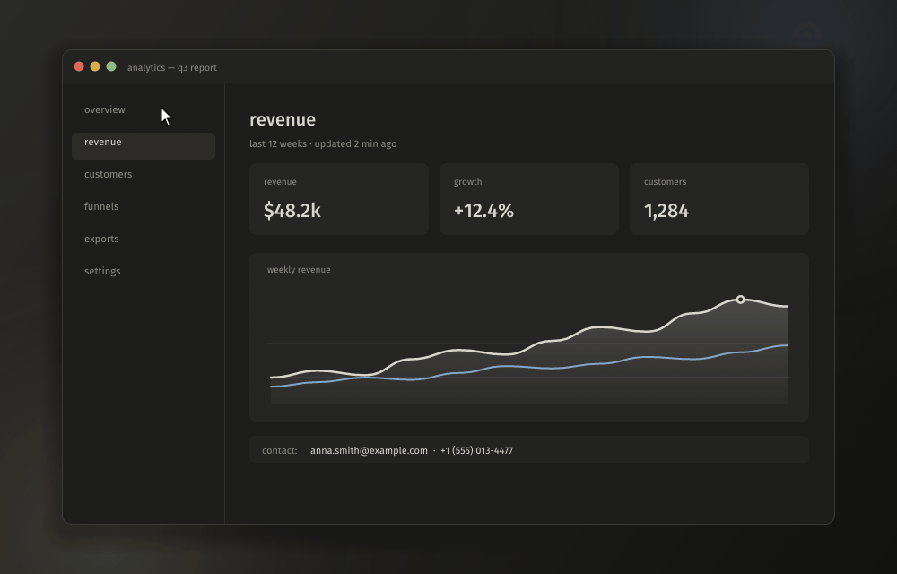

<div align="center">


# blinker

**A fast, quiet screenshot and screen recording tool for Windows.**
Capture, annotate and share in a couple of keystrokes. It lives in the tray and stays out of the way.

**English** · [Русский](README.ru.md)




<sub>select an area → arrow → numbered steps → blur the email → copy</sub>

</div>

## Features

### Screenshots

- **Area capture.** The screen freezes and dims around your selection. Click a window to capture just that window. A loupe shows exact pixels, coordinates and the HEX color under the cursor.
- **Draw before you capture.** Arrows, pen, marker, numbered steps, blur, black-out and text, plain or on a plate. Everything inside the frame is baked into the shot.
- **Tools panel wherever you like:** at the top of the screen, above or below the selection, or as a column to its right.
- **One-key actions:** copy, save, open in the editor, pin on top of other windows, make a "beauty shot" (background, padding, rounded corners, shadow, 16:9 / 1:1 / 4:5) or upload and copy the link.
- **Full screen, active window, repeat the last area.**
- **Notification with a preview.** Drag it straight into a chat, a browser or Explorer as a file.

### Editor

- Arrow, line, rectangle, ellipse, pen, marker, text, pixelate, steps, crop.
- Colors, stroke widths, undo/redo, zoom and pan.

### Screen recording

- **An area, a window or a whole monitor** to MP4 (H.264 or HEVC) on the GPU's hardware encoder. Frames go GPU → encoder with no copies through memory.
- **Window recording** keeps following the window even when it's covered or moved, and the control pill follows it too.
- **System sound and microphone on separate tracks**, pause and resume, and visible clicks and key combos (plain typing is never shown).
- **GIF recording** with a built-in encoder: one global palette and only the changed rectangles, so GIFs stay small.
- **Instant replay.** The last 30 s to 5 min are always ready to save with one hotkey, without re-encoding.
- **Video editor:** trim, track volume and mute, export to MP4 (one mixed track for messengers or separate tracks for editing) or GIF.

### Everyday

- Saves to `Pictures/Blinker/<date>/pics` and `…/videos` (or a single folder) as PNG, lossless WebP or JPEG.
- Tray menu, and both mouse buttons on the tray icon can be bound to any action.
- Every action can have several hotkeys.
- Russian and English interface.
- The "Graphite" look: warm dark gray with one light accent, Fira Sans / Fira Mono.
- Lightweight: each window (overlay, editor, settings) is created on demand and fully destroyed when closed.

## Hotkeys

| Where | Keys |
| --- | --- |
| Anywhere | `PrtSc` area · `Ctrl+PrtSc` screen · `Shift+PrtSc` repeat last area · `Ctrl+Shift+PrtSc` record (again to stop) · `Ctrl+Alt+P` pause · `Ctrl+Alt+PrtSc` save replay |
| Selecting | drag: area · click: window · `Space` monitor · `Ctrl+A` all monitors · `Enter` / `Ctrl+C` / double click: copy · `Ctrl+S` save · `E` editor · `P` pin · `B` beauty shot · `U` upload · `1`–`9` tools · `Ctrl+Z` undo · arrows nudge (`Shift` ×10) · wheel: loupe zoom · `C` copy color · `Esc` / right click: cancel |
| Editor | `V A L R O P M T B N C` tools · `1 2 3` width · `Ctrl+Z/Y` · `Ctrl+C` · `Ctrl+S` · `Ctrl+Shift+S` · `Space`+drag pan · `Ctrl+0` fit · `Ctrl+1` 100% |
| Video editor | `Space` play/pause · `←`/`→` ±1 s (`Shift` ±5 s) · `I`/`O` in/out · `Home`/`End` · `Ctrl+S` MP4 |

All global hotkeys can be changed in settings → hotkeys.

> If `PrtSc` opens the Windows Snipping Tool instead, turn off *Settings → Accessibility → Keyboard → Use the Print Screen key to open screen capture*.

## Download

Grab `blinker.exe` from [Releases](https://github.com/justkiddingxd/blinker/releases/latest) and run it. It is a single file with nothing to install. It opens the settings window and keeps running in the tray. Autostart is in settings → system.

Windows SmartScreen may warn about an unsigned app: click *More info → Run anyway*.

## Build

You need [Rust](https://rustup.rs) (stable, edition 2024) and Windows 10 1903+ or Windows 11.

```bash
git clone https://github.com/justkiddingxd/blinker
cd blinker
cargo build --release
```

The result is a single `target/release/blinker.exe` with nothing to install.

```text
blinker.exe                  settings window + tray
blinker.exe --background     tray only (how autostart launches it)
blinker.exe --capture        start selecting an area right away
blinker.exe picture.png      open an image in the editor
```

Settings live in `%APPDATA%\Blinker\config.toml`.

**Optional:** with [ffmpeg](https://ffmpeg.org) on `PATH`, blinker uses it to re-encode videos for Telegram with a tuned NVENC / x264 recipe. Without it the built-in Media Foundation encoder does the job.

## Upload server protocol

Uploads go to any server that speaks this:

```text
POST <url from settings>
Authorization: Bearer <token>          (if set)
Content-Type: image/png | image/jpeg | image/webp | image/gif | video/mp4
X-Filename: <file name, percent-encoded UTF-8>
<body: the file>

200/201  {"url": "https://…", "delete_url": "…"}   (delete_url is optional)
4xx/5xx  {"error": "message"}
```

## Inside

| | |
| --- | --- |
| `main.rs` | controller: command queue, window order |
| `shell.rs` | tray and global hotkeys (own Win32 message loop) |
| `capture.rs` | desktop capture and window list |
| `overlay.rs` · `toast.rs` · `home.rs` · `editor/` | windows |
| `record/` | recording: Windows Graphics Capture, WASAPI, Media Foundation, the HUD |
| `vedit/` · `media.rs` | video editor, MP4/GIF export, reading files |
| `demo.rs` | `--demo <dir> [en\|ru]`: plays the animation above off-screen and saves its frames |

## License

[GPL-3.0](LICENSE). The bundled Fira fonts are under the SIL Open Font License 1.1.
