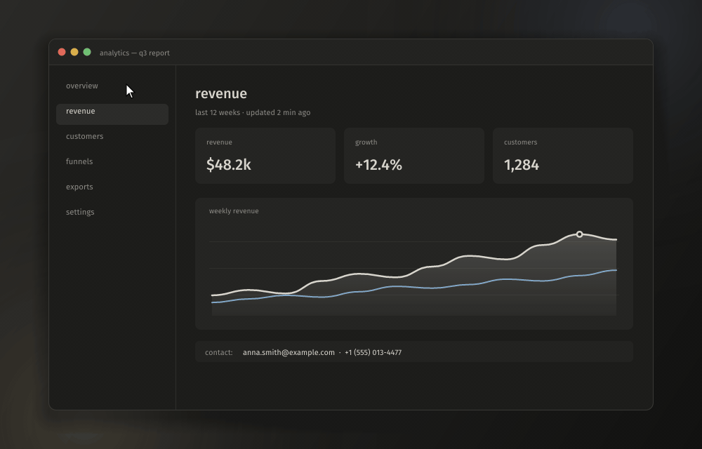
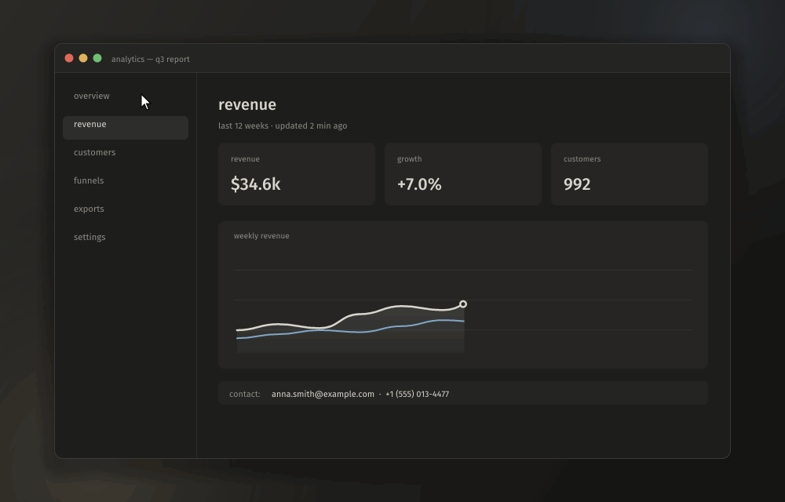
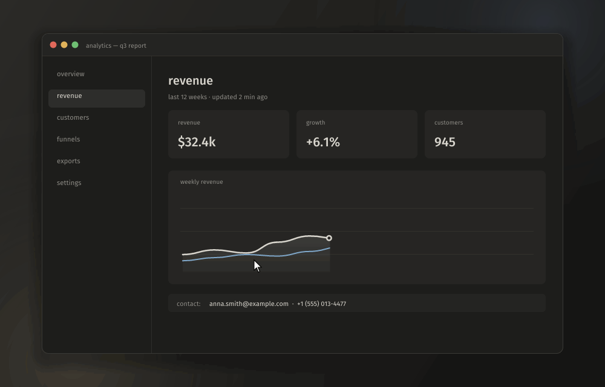

<div align="center">


# blinker

**Быстрая и тихая программа для скриншотов и записи экрана в Windows и macOS.**
Снять, разметить и отправить можно за пару нажатий. Живёт в трее (на маке — в строке меню) и не мешает.

[English](README.md) · **Русский**




<sub>выделил область → стрелка → номера шагов → размыл почту → скопировал</sub>

</div>

## Что умеет

### Скриншоты

- **Снимок области.** Экран замирает и затемняется вокруг выделения. Клик по окну снимает только это окно. Лупа показывает пиксели, координаты и HEX-цвет под курсором.
- **Рисование до снимка.** Стрелки, карандаш, маркер, номера шагов, размытие, чёрная заливка, текст с подложкой и без. Всё, что внутри рамки, попадает в снимок.
- **Панель инструментов где удобно:** сверху экрана, над или под выделением, или столбиком справа от него.
- **Действия одной клавишей:** скопировать, сохранить, открыть в редакторе, закрепить поверх окон, сделать «красивый снимок» (фон, отступы, скругление, тень, 16:9 / 1:1 / 4:5) или загрузить и скопировать ссылку.
- **Весь экран, активное окно, повтор последней области.**
- **Уведомление с превью.** Его можно перетащить прямо в чат, браузер или проводник как файл.

### Редактор

- Стрелка, линия, прямоугольник, овал, карандаш, маркер, текст, пикселизация, шаги, обрезка.
- Цвета, толщина линий, отмена и повтор, масштаб и прокрутка.

### Запись экрана

<div align="center">

<sub>нажал <code>Ctrl+Shift+PrtSc</code> → выделил область → запись → стоп: видео сохранено</sub>
</div>

- **Область, окно или весь монитор** в MP4 (H.264 или HEVC) через аппаратный кодировщик видеокарты. Кадры идут из видеокарты в кодировщик без копий через память.
- **Запись окна** продолжается, даже если окно перекрыли или подвинули, и плашка с кнопками ездит за ним.
- **Звук системы и микрофон на отдельных дорожках**, пауза, клики и сочетания клавиш в видео (обычный набор текста не показывается).
- **Запись в GIF** встроенным кодировщиком: одна палитра на весь ролик и только изменившиеся участки, поэтому гифки лёгкие.
- **Повтор.** Последние минуты (от 1 до 30, сколько скажешь) всегда готовы, сохраняются одной клавишей без перекодирования; сохранение может начинать повтор заново. Пока он пишется, иконка в трее красная.
- **Редактор видео:** обрезка, громкость и отключение дорожек, метки с текстом (`M`), сохранение в MP4 (звук одной дорожкой для мессенджеров или раздельно для монтажа), в GIF, а без видео — только звук в MP3 / M4A / WAV.
- **Загрузка и ссылки:** по умолчанию на [post.blinker.cool](https://post.blinker.cool) (без регистрации, 3 дня, видео до 100 мб): у каждой ссылки страница с просмотром картинки или плеером, где видны метки видео. Или на свой сервер, или через любой загрузчик ShareX (`.sxcu`).
- **Переезд с ShareX** одной кнопкой: горячие клавиши, папка, формат, что делать после снимка, уведомление, звук и загрузчик.

<div align="center">

<sub>что-то случилось на экране → <code>Ctrl+Alt+PrtSc</code> → последние 30 секунд уже в видео</sub>
</div>

### Каждый день

- Сохраняет в `Изображения/Blinker/<дата>/pics` и `…/videos` (или в одну папку) в PNG, WebP без потерь или JPEG.
- Меню в трее, а на обе кнопки мыши по значку можно назначить любое действие.
- На каждое действие можно назначить несколько сочетаний клавиш.
- Русский и английский интерфейс.
- Оформление «Графит»: тёплый тёмно-серый с одним светлым акцентом, шрифты Fira Sans / Fira Mono.
- Лёгкая: каждое окно (оверлей, редактор, настройки) создаётся по требованию и полностью закрывается после использования.

## Горячие клавиши

| Где | Клавиши |
| --- | --- |
| Везде | `PrtSc` область · `Ctrl+PrtSc` экран · `Shift+PrtSc` повторить область · `Ctrl+Shift+PrtSc` запись (ещё раз, чтобы остановить) · `Ctrl+Alt+P` пауза · `Ctrl+Alt+PrtSc` сохранить повтор |
| Выделение | тянуть: область · клик: окно · `Пробел` монитор · `Ctrl+A` все мониторы · `Enter` / `Ctrl+C` / двойной клик: скопировать · `Ctrl+S` сохранить · `E` редактор · `P` закрепить · `B` красивый снимок · `U` загрузить · `0`–`9` инструменты · `Ctrl+Z` отменить · стрелки сдвигают (`Shift` ×10) · колесо: масштаб лупы · `C` скопировать цвет · `Esc` / правый клик: отмена |
| Редактор | `V A L R O P M T B N C` инструменты · `1 2 3` толщина · `Ctrl+Z/Y` · `Ctrl+C` · `Ctrl+S` · `Ctrl+Shift+S` · `Пробел`+тянуть: прокрутка · `Ctrl+0` вписать · `Ctrl+1` 100% |
| Редактор видео | `Пробел` играть/пауза · `←`/`→` ±1 с (`Shift` ±5 с) · `I`/`O` начало и конец фрагмента · `M` метка · `Home`/`End` · `Ctrl+S` сохранить |

Все глобальные сочетания меняются в настройках, вкладка «горячие клавиши».

> Если `PrtSc` открывает «Ножницы» Windows, выключи *Параметры → Специальные возможности → Клавиатура → Использовать клавишу Print Screen для запуска функции создания фрагмента экрана*.

**На маке** ⇧⌘3, ⇧⌘4 и ⇧⌘5 заняты системой, поэтому сочетания по умолчанию стоят рядом:

| Где | Клавиши |
| --- | --- |
| Везде | `⇧⌘2` область · `⇧⌘1` экран · `⌥⇧⌘2` повторить область · `⇧⌘7` запись (ещё раз, чтобы остановить) · `⌃⌥P` пауза · `⌥⇧⌘7` сохранить повтор |
| Выделение, редакторы | те же клавиши, что выше, с `⌘` вместо `Ctrl` |

## Скачать

Скачай `blinker.exe` в [Releases](https://github.com/justkiddingxd/blinker/releases/latest) и запусти. Это один файл, устанавливать ничего не нужно. Откроются настройки, а сама программа останется в трее. Автозапуск включается в настройках, вкладка «система».

Windows SmartScreen может ругнуться на неподписанную программу: нажми *Подробнее → Выполнить в любом случае*.

**macOS 14 Sonoma и новее:** скачай `Blinker.dmg` на [blinker.cool](https://blinker.cool) или в Releases, перетащи Blinker в *Программы* и открой. Программа живёт в строке меню. Она не заверена Apple, поэтому в первый раз macOS её заблокирует: нажми *Готово*, затем *Системные настройки → Конфиденциальность и безопасность → Всё равно открыть* (или выполни `xattr -dr com.apple.quarantine /Applications/Blinker.app`). Пошаговый [гайд на сайте](https://blinker.cool/#mac). macOS спросит разрешения, каждое в момент, когда оно впервые понадобится:

- **Запись экрана и системного звука** для скриншотов и записи. После разрешения выйди из blinker через его меню и открой снова.
- **Микрофон**, если записываешь его (нужна macOS 15).
- **Мониторинг ввода**, только чтобы показывать сочетания клавиш в записи. Клики видны и без него.

## Сборка

Нужен [Rust](https://rustup.rs) (stable, edition 2024) и Windows 10 1903+ или Windows 11, либо macOS 14+ с инструментами командной строки Xcode (`xcode-select --install`).

```bash
git clone https://github.com/justkiddingxd/blinker
cd blinker
cargo build --release
```

Получится один файл `target/release/blinker.exe`, устанавливать ничего не нужно.

```text
blinker.exe                  окно настроек + трей
blinker.exe --background     только трей (так запускается автозапуск)
blinker.exe --capture        сразу выделение области
blinker.exe picture.png      открыть картинку в редакторе
```

Настройки хранятся в `%APPDATA%\Blinker\config.toml`.

**Релизы:** отправь тег вида `v0.2.0` (тот же, что `version` в `Cargo.toml`), и GitHub Actions соберёт `blinker.exe`, `Blinker.dmg` и `Blinker-macos.zip` и приложит их к релизу (`.github/workflows/release.yml`; маковский сертификат берётся из секретов `BLINKER_P12_BASE64` / `BLINKER_P12_PASSWORD`). Запущенные копии увидят новую версию в настройках и обновятся в один клик.

На маке `scripts/macos-app.sh` собирает `target/release/Blinker.app`, `Blinker.dmg` и zip с ним (`UNIVERSAL=1` — для Apple silicon и Intel сразу). Окно dmg раскладывает [dmgbuild](https://github.com/dmgbuild/dmgbuild), скрипт сам ставит его в `target/dmgbuild`; фон рисует `scripts/dmg-background.swift`. Перед первой сборкой один раз запусти `scripts/macos-signing.sh`: он создаёт сертификат подписи в отдельной связке ключей, и все подписанные им сборки сохраняют разрешение на запись экрана (с подписью ad hoc каждую сборку приходится разрешать заново). Сохрани копию `.p12`, путь к которому он выведет: с новым сертификатом всем пользователям придётся разрешать запись снова. Те же флаги работают у файла внутри, `Blinker.app/Contents/MacOS/blinker`. Настройки лежат в `~/Library/Application Support/Blinker/config.toml`, снимки — в `~/Pictures/Blinker`. Оверлей выделения — отдельное окно на каждом дисплее (у каждого дисплея на маке своё пространство); выделение — в пределах одного дисплея.

**Необязательно:** если в `PATH` есть [ffmpeg](https://ffmpeg.org) (на маке подойдёт и из Homebrew), blinker пережимает им видео под Telegram по настроенному рецепту NVENC / x264. Без него это делает встроенный кодировщик: Media Foundation в Windows, VideoToolbox на маке.

## Загрузка: протокол сервера

Если свой сервер не задан, файлы уходят на [post.blinker.cool](https://post.blinker.cool). Сервер за ним лежит в [`server/`](server/README.ru.md): `docker compose up` поднимает такой же у себя. Подойдёт любой сервер, который понимает такой запрос:

```text
POST <адрес из настроек>
Authorization: Bearer <токен>          (если задан)
Content-Type: image/png | image/jpeg | image/webp | image/gif | video/mp4 | audio/mpeg | audio/mp4 | audio/wav
X-Filename: <имя файла, percent-encoded UTF-8>
X-Blinker-Markers: <percent-encoded [{"t": 12.5, "text": "…"}]>   (видео с метками)
<тело: сам файл>

200/201  {"url": "https://…", "delete_url": "…"}   (delete_url необязателен)
4xx/5xx  {"error": "текст"}
```

## Устройство

| | |
| --- | --- |
| `main.rs` | контроллер: очередь команд, порядок окон |
| `shell.rs` | трей и глобальные горячие клавиши (свой цикл сообщений Win32) |
| `capture.rs` | захват рабочего стола и список окон |
| `overlay.rs` · `toast.rs` · `home.rs` · `editor/` | окна |
| `record/` | запись: Windows Graphics Capture, WASAPI, Media Foundation, плашка |
| `vedit/` · `media.rs` | редактор видео, экспорт MP4/GIF, чтение файлов |
| `demo.rs` · `scripts/demos.sh` | `--demo <папка> [en\|ru] [record\|replay]` проигрывает анимации сверху вне экрана и сохраняет кадры; скрипт делает из них GIF для README и видео для сайта (на маке маковские) |
| `server/` | сервер [post.blinker.cool](https://post.blinker.cool) (на сервер его кладёт `scripts/deploy-post.sh root@SERVER`) |
| `sharex.rs` | перенос настроек из ShareX |
| `site/` | [blinker.cool](https://blinker.cool): скачивание и гайд для мака (статика; пуш в `main` сам выкладывает её на сервер, `.github/workflows/site.yml`) |
| `mac/` | сборка для macOS: тот же платформенный слой поверх AppKit, ScreenCaptureKit, AVFoundation и хоткеев Carbon (`mac/native/*.m`, собирает `build.rs`) |

## Лицензия

[GPL-3.0](LICENSE). Встроенные шрифты Fira распространяются по SIL Open Font License 1.1.
